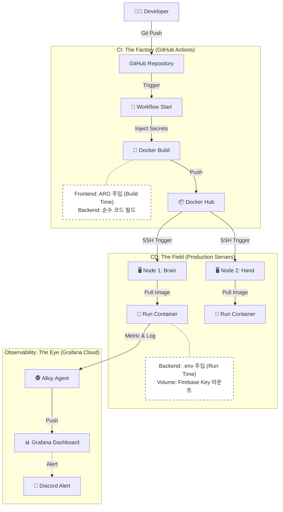

# 🚀 배포 및 인프라 가이드 (Deployment & Infrastructure)

이 문서는 CI/CD 파이프라인 구조, SSL 인증서 전략, 멀티 아키텍처 빌드의 의사결정을 설명합니다.

> 로컬 실행 명령어, 운영 서버별 배포 절차, 환경 변수 설정은 → [RUNBOOK.md](RUNBOOK.md)

---

## 1. CI/CD 파이프라인 (GitHub Actions)

**Zero-Touch Deployment**를 위해 코드가 푸시되면 빌드부터 배포까지 자동으로 수행됩니다.

### 🏭 전략: Build Time vs Run Time (The Separation)
로컬 개발 환경과 달리, CI/CD 환경에서는 **"변수 주입 시점"** 이 핵심입니다. 보안과 프레임워크 특성에 따라 주입 시점을 엄격히 분리했습니다.

| 구분 | Build Time (공장/조립) | Run Time (현장/실행) |
| :--- | :--- | :--- |
| **개념** | 도커 이미지를 굽는(Build) 시점 | 컨테이너를 실행(Up)하는 시점 |
| **주체** | **GitHub Actions** (Runner) | **Operating Server** (Brain/Hand) |
| **대상** | **Frontend (React)** | **Backend (Java/Python)** |
| **이유** | React는 빌드 시점에 환경변수가 JS 코드로 치환(Hardcoded)되어 정적 파일로 변환됨. | 서버 애플리케이션은 실행 시점에 OS 환경변수나 파일을 읽어서 동적으로 설정함. |
| **방법** | `ARG` & `build-args`로 GitHub Secrets 주입 | `env_file` (.env) 및 `Volume Mount`로 서버 파일 주입 |

### 🔄 파이프라인 흐름도 (Workflow Diagram)
개발자가 코드를 푸시하면 **'공장(CI)'**에서 이미지를 만들고, **'현장(CD)'**으로 배송하여 실행하며, **'관제탑(Alloy)'**이 이를 감시하는 구조입니다.



### 🔄 워크플로우 파일 구조 (`.github/workflows/`)

| 파일명 | 역할 | 트리거 조건 |
| :--- | :--- | :--- |
| `deploy-brain.yml` | Backend(Java) 빌드·테스트 및 Node 1 배포 | `apps/catalog-service/**` 변경 시 |
| `deploy-face.yml` | Frontend(React) 빌드 및 Node 1 배포 | `apps/frontend/**` 변경 시 |
| `deploy-hand.yml` | Crawler(Python) 빌드 및 Node 2 (Shard A) 배포 | `apps/collector-service/**` 변경 시 |
| `deploy-hand-3.yml` | Crawler(Python) 빌드 및 Node 3 (Shard B) 배포 | `apps/collector-service/**` 변경 시 |
| `deploy-observability.yml` | Alloy(Monitoring) 설정 배포 및 재시작 | `config.alloy` 변경 시 |

### 🛠️ 빌드 타임 변수 주입 전략 (Frontend)
React는 런타임에 환경변수를 읽을 수 없으므로, Docker 빌드 시점에 값을 주입하는 것이 핵심입니다.

```Dockerfile
# ARG로 변수 선언 후 ENV로 변환하여 npm build에 노출
ARG VITE_API_BASE_URL
ARG VITE_FIREBASE_API_KEY
ENV VITE_API_BASE_URL=$VITE_API_BASE_URL
ENV VITE_FIREBASE_API_KEY=$VITE_FIREBASE_API_KEY
RUN npm run build
```

```yaml
# GitHub Actions에서 Secrets를 build-args로 주입
- name: Build and push Docker image
  uses: docker/build-push-action@v5
  with:
    build-args: |
      VITE_API_BASE_URL=${{ secrets.VITE_API_BASE_URL }}
      VITE_FIREBASE_API_KEY=${{ secrets.VITE_FIREBASE_API_KEY }}
      VITE_GA_MEASUREMENT_ID=${{ secrets.VITE_GA_MEASUREMENT_ID }}
```

**환경 변수 관리 전략:**
- GitHub Secrets: CI 단계의 빌드 재료(React Key)와 배포 자격 증명(SSH Key, Docker ID) 암호화 저장.
- Server .env: CD 단계(런타임)의 DB 비밀번호, Discord URL 등은 운영 서버 내부 `.env` 파일로 격리.
- Hybrid Loading: FirebaseConfig 등 핵심 설정 클래스는 "환경변수가 있으면 그것을(Prod), 없으면 내부 파일을(Local)" 읽도록 설계하여 코드 수정 없이 환경 대응.

### 🛡️ 신뢰성 중심 배포 & CI/CD 최적화 (Reliability-First & Cached CI/CD)
기존에는 빌드 속도를 위해 테스트를 생략(`-x test`)했으나, 안정성 확보를 위해 **배포 전 테스트 수행과 배포 후 헬스체크 검증을 의무화**했습니다.
- **테스트 게이트**: CI 파이프라인의 독립 스텝(`Run Tests`)에서 `./gradlew test`가 수행됩니다 (Gradle 9.2.1 + Java 25 툴체인, Spring Boot 4.1.2). 테스트 실패 시(Red) 이후 빌드·배포 단계가 즉시 중단됩니다.
- **Layered JAR & 빌드 캐시**:
  - `catalog-service` 이미지는 `eclipse-temurin:25-jdk-noble` 빌더에서 `./gradlew bootJar` 후 `extract --layers --launcher`로 의존성·로더·애플리케이션 레이어를 분리해 `eclipse-temurin:25-jre-noble` 런타임에 복사합니다.
  - `deploy-brain.yml`과 `deploy-face.yml` 모두 `actions/cache@v4` 및 `docker/build-push-action@v6`의 GitHub Actions Buildx 캐시(`cache-from/to: type=gha,mode=max`, `scope=brain` / `scope=face`)를 적용해 재빌드 시간을 단축했습니다.
- **헬스체크 자동 검증 (`--wait`)**:
  - `catalog-service` 컨테이너는 `curl` 패키지 설치 없이 내장 `bash` `/dev/tcp/127.0.0.1/8080`으로 `/actuator/health` 200 응답을 확인합니다.
  - SSH 배포 단계에서 `docker compose -f docker-compose-brain.yml up -d --wait --wait-timeout 120 catalog-service`를 실행하여, 신규 컨테이너가 실제로 `(healthy)` 상태에 도달하지 못하면 최근 로그 50줄을 출력하고 CI를 즉시 실패 처리합니다.
- **인프라 컨테이너 분리 원칙**:
  - `mysql`, `meilisearch`, `caddy`, `adminer` 같은 영구 데이터·인프라 컨테이너는 앱 배포(`deploy-brain.yml`) 때마다 재시작하지 않고 서버에 상시 유지합니다. `meilisearch`는 `ps-network` 내부 전용(외부 포트 미노출, `wget` 헬스체크, `0.5 CPU / 384M RAM`, `meili_data` 볼륨)으로 운영되며 장애 시 API가 MySQL로 자동 폴백합니다.

---

## 2. 리버스 프록시, SSL & 트래픽 방어 (Caddy + Nginx)

Nginx + Certbot 방식에서 **Caddy**로 전환하여 SSL 인증서 관리를 완전 자동화하고, 내부 **Nginx**에서 라우팅·보안 헤더·Rate Limiting을 담당합니다.

### 🔒 Caddy 설정 (Caddyfile)

```
ps-signal.com, www.ps-signal.com {
    reverse_proxy frontend:80
}
```

이 3줄만으로 Let's Encrypt 인증서 발급, 갱신, HTTPS 리다이렉트를 Caddy가 내부에서 모두 처리합니다. 별도의 crontab, certbot 컨테이너, 볼륨 마운트가 필요 없습니다.

> **이전 방식 (Nginx + Certbot, 현재 미사용)**
>
> 초기에는 Certbot + crontab으로 Let's Encrypt 인증서를 발급/갱신했습니다.
> 서버 이전 시마다 certbot 컨테이너·crontab·볼륨 마운트를 모두 재구성해야 하는 운영 부담이 있었으며,
> Oracle A1 신규 서버 이전을 계기로 Caddy로 전환하여 이 부담을 완전히 제거했습니다.

### 🛡️ Nginx 4단계 API Rate Limiting & 경로 보호 (`nginx.prod.conf`)

외부 트래픽이 모두 `Caddy → Nginx → Spring Boot` 단일 경로로 진입하므로, JVM·BCrypt·DB 부하가 발생하기 전에 Nginx 앞단에서 경로별 차등 속도 제한을 적용합니다.

- **Real IP 복원**: `frontend` 컨테이너는 외부 포트 없이 Docker 내부망(`expose: 80`)으로만 Caddy와 통신합니다. 사설망 대역(`172.16.0.0/12`, `10.0.0.0/8`, `192.168.0.0/16`)에서 전달된 `X-Forwarded-For`에 `real_ip_recursive on`을 적용해 실제 클라이언트 IP를 복원하고 헤더 스푸핑 우회를 차단합니다.
- **표준 `429` 응답 & UI 연동**: `limit_req_status 429`를 명시하여 Nginx 기본값(`503`)으로 인해 프론트엔드 `backend-booting` 화면이 오동작하는 것을 방지하고, `client.js`에서 `429` 안내 토스트를 표시합니다.

| 구분 | 대상 경로 | 제한 (`rate` / `burst`) | 설계 근거 |
| :--- | :--- | :--- | :--- |
| **인증** | `/api/v1/auth/login`, `/api/v1/members/signup` | `5r/m`, `burst=5 nodelay` | BCrypt CPU 보호 및 브루트포스·가입 스팸 방어 |
| **토큰 재발급** | `/api/v1/auth/reissue` | `10r/m`, `burst=10 nodelay` | 다중 탭·공유 IP Silent Refresh 허용 + 무한 루프 차단 |
| **검색·자동완성** | `/api/v1/games/search`, `/api/v1/games/suggest` | `5r/s`, `burst=15 nodelay` | Meilisearch·MySQL 하이브리드 검색 남용 및 폴백 시 DB 부하 방어 |
| **일반 API** | `/api` | `10r/s`, `burst=30 nodelay` | SPA 초기 동시 요청 및 모바일 공유 IP(NAT) 수용 |
| **제외** | `/`, `/assets/`, `/sitemap-games.xml`, `/api/og/` | 제한 없음 | SEO 크롤러(Googlebot·Yeti), 광고 심사, SNS 미리보기 봇 보호 *(GA4는 브라우저→Google 직접 전송)* |

- **내부 전용 경로 차단**: 크롤러 전용 수집 엔드포인트(`/api/internal`, `/api/v1/games/collect` 등)와 `/actuator`는 Nginx에서 `404`로 원천 차단하고, MySQL 포트는 호스트 `127.0.0.1:3306`으로만 바인딩하여 외부 노출을 제거했습니다.

---

## 3. 멀티 아키텍처 빌드 전략 (Multi-Architecture Build)

### 🏗️ 배경: ARM64 서버 이전과 에뮬레이션 문제

Oracle A1 ARM64 서버로 이전 후, 초기에는 기존 AMD64 이미지에 `platform: linux/arm64`를 추가하여 실행했습니다. 그러나 성능 체감이 없었는데, 원인은 **QEMU가 런타임에 모든 CPU 명령어를 실시간 번역**하여 실제 서버 성능의 30~50%만 발휘되었기 때문입니다.

### 🔧 해결: 플랫폼별 네이티브 이미지 빌드

GitHub Actions의 **QEMU + Buildx** 조합으로 `linux/amd64,linux/arm64` 멀티 플랫폼 이미지를 빌드하여 Docker Hub에 푸시합니다. A1 서버는 자신의 아키텍처에 맞는 ARM64 네이티브 이미지를 자동으로 선택하여 실행하므로 에뮬레이션 오버헤드가 없습니다.

```yaml
- name: Build and Push Docker Image
  uses: docker/build-push-action@v6
  with:
    platforms: linux/amd64,linux/arm64  # 두 아키텍처 동시 빌드
    push: true
    cache-from: type=gha,scope=brain
    cache-to: type=gha,mode=max,scope=brain
```

이 방식은 **인프라 이식성(Portability)**도 보장합니다. Docker Hub에 올라간 이미지가 어떤 아키텍처 서버에서도 최적 성능으로 실행 가능하므로, 이후 서버 이전 시 코드 수정 없이 즉시 배포 가능합니다.

### ⚡ 프론트엔드 Builder 스테이지 최적화

`npm ci`는 QEMU 에뮬레이션 환경에서 **4시간 이상 소요 후 크래시**(`Illegal instruction`)가 발생했습니다. `FROM --platform=$BUILDPLATFORM`으로 Builder 스테이지를 CI 러너(AMD64)의 네이티브 환경에서 실행하여 해결했습니다.

```dockerfile
# Builder는 CI 러너(AMD64)에서 네이티브로 실행 → npm 크래시 없음
FROM --platform=$BUILDPLATFORM node:22-alpine AS builder
RUN npm ci && npm run build

# Final 스테이지는 타겟 플랫폼(ARM64)으로 빌드됨
FROM nginx:alpine
COPY --from=builder /app/dist /usr/share/nginx/html
```

이 방식은 **자급자족 Dockerfile**을 유지하면서(로컬 `docker build .` 정상 동작), CI 빌드 시간도 대폭 단축합니다.
