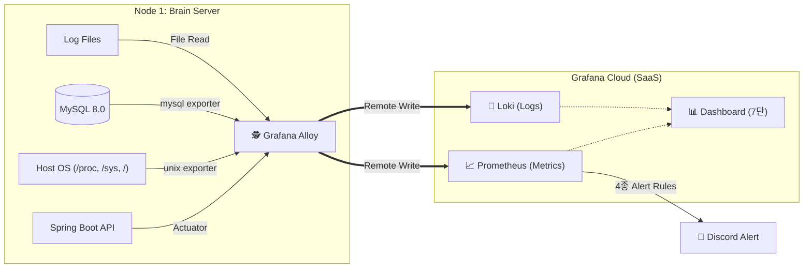

# 📡 관측성 및 모니터링 가이드 (Observability with PLG)

이 문서는 제한된 리소스(초기 1GB RAM, 현 Node 1 2코어 8GB ARM64) 환경에서 모니터링 오버헤드를 최소화하면서 서버 상태를 실시간으로 감시하기 위해 구축한 **PLG 스택(Prometheus, Loki, Grafana)** 의 아키텍처와 설정 방법을 설명합니다.

---

## 1. 모니터링 아키텍처 (Architecture)

우리는 자체 모니터링 서버를 구축하는 대신, **Grafana Cloud (SaaS)** 를 활용하여 운영 부담을 덜고 리소스를 절약하는 전략을 선택했습니다.

### 🏗️ 데이터 흐름 (Data Flow)
서버에 설치된 초경량 수집기(**Alloy**)가 데이터를 긁어서(Pull/Read), 클라우드 저장소로 전송(Push)합니다.



---

## 2. 리소스 다이어트 전략 (Resource Optimization)

초기 Oracle Cloud Free Tier(1GB RAM) 환경에서 모니터링 에이전트가 메인 서비스(Java)를 죽이는 주객전도 현상을 막기 위해 철저한 리소스 제한을 적용했으며, 2코어 8GB ARM64 서버로 이전한 현재도 경량 구성을 유지하고 있습니다.

### 📉 용량 산정 과정 (Capacity Planning)
단순한 감(Guess)이 아닌, **실제 운영 중인 컨테이너의 리소스 점유율(Footprint)** 을 측정하여 최적의 한계점을 산출했습니다.

1. **측정 명령어 (Monitoring Command):**
   ```bash
   # 실시간 컨테이너 리소스 점유율 확인
   docker stats --no-stream
   ```
   
2. 튜닝 기록 (Tuning Log):
- 1차 시도 (0.1 CPU / 64MB): 초기 구동은 성공했으나, 로그 수집량이 급증하는 시점에 메모리 부족으로 컨테이너가 강제 재시작(Restart)되는 현상 발견.
- 2차 결정 (0.2 CPU / 128MB): App 메트릭·로그 수집 시 평시 점유율(약 40~50MB) 대비 2배 이상의 안전 마진을 확보하여 OOM 방지.
- 3차 확장 (0.3 CPU / 256MB — 현재): Alloy 내장 `unix`(Node 1 OS) 및 `mysql` exporter를 추가해 **App + Host + DB 3계층 관측성**으로 확장하면서 리소스 여유를 상향.
   
### 📉 Grafana Alloy 컨테이너 제한 (`docker-compose-brain.yml`)

```yaml
deploy:
  resources:
    limits:
      cpus: '0.3'        # CPU 30% 초과 사용 금지
      memory: "256M"     # 메모리 256MB 초과 시 OOM Kill
```

- Lightweight: 별도 exporter 컨테이너를 띄우지 않고 Go 기반 단일 Alloy 에이전트에 내장 exporter(`unix`, `mysql`) 통합.
- Free Tier Series Budget: Grafana Cloud 무료 티어 한도(Active Series 10,000)를 준수하기 위해 `set_collectors`로 필수 지표만 선별하고 가상·도커 마운트를 제외하여 **456 → 1,468개(한도의 14.7%)**로 억제.
- Log Throttling: 로그 수집 주기를 2분(`sync_period = "2m"`)으로 설정하여 디스크 I/O 부하 최소화.

---

## 3. 수집 설정 분석 (`config.alloy`)

Alloy가 어떻게 **App · Host · MySQL** 3계층 메트릭과 로그를 수집하고 전송하는지에 대한 핵심 설정입니다.

### ① App 메트릭 수집 (Spring Boot Actuator)
Spring Boot Actuator가 노출하는 엔드포인트를 30초 주기로 스크래핑합니다.

```alloy
prometheus.scrape "spring_app" {
    targets = [
        // 같은 도커 네트워크에 있으므로 서비스명(catalog-service)으로 접근
        {__address__ = "catalog-service:8080"},
    ]
    metrics_path    = "/actuator/prometheus"
    scrape_interval = "30s"
    forward_to      = [prometheus.remote_write.grafana_cloud_metrics.receiver]
}
```

### ② Host (Node 1 OS) 메트릭 수집 (`prometheus.exporter.unix`)
`docker-compose-brain.yml`에서 호스트 `/proc`, `/sys`, `/`를 읽기 전용(`/host/*:ro`)으로 마운트하고, 핵심 5개 collector만 선별합니다.

```alloy
prometheus.exporter.unix "node1_host" {
    procfs_path = "/host/proc"
    sysfs_path  = "/host/sys"
    rootfs_path = "/host/root"

    set_collectors = ["cpu", "meminfo", "filesystem", "loadavg", "diskstats"]

    filesystem {
        mount_points_exclude = "^/(dev|proc|sys|run|snap|var/lib/docker/.+|var/lib/containerd/.+)($|/)"
        fs_types_exclude     = "^(autofs|binfmt_misc|bpf|cgroup2?|configfs|debugfs|devpts|devtmpfs|fusectl|hugetlbfs|iso9660|mqueue|nsfs|overlay|proc|procfs|pstore|rpc_pipefs|securityfs|selinuxfs|squashfs|sysfs|tracefs|tmpfs)$"
    }
}
```

### ③ MySQL 서버 내부 메트릭 수집 (`prometheus.exporter.mysql`)
보안상 `root` 대신 비즈니스 테이블 접근 권한이 없는 최소 권한 전용 계정(`alloy_exporter`, `MAX_USER_CONNECTIONS 3`, `PROCESS` + `REPLICATION CLIENT` + `SELECT ON performance_schema.*`)을 생성하고 `.env`의 `MYSQL_EXPORTER_DSN`으로 주입합니다.

```alloy
prometheus.exporter.mysql "pstracker_mysql" {
    data_source_name = sys.env("MYSQL_EXPORTER_DSN")
    set_collectors   = ["global_status", "global_variables", "info_schema.processlist"]
}
```

### ④ 로그 수집 (Loki File Read)
서버에 쌓이는 로그 파일을 직접 읽어서 전송합니다.

```alloy
local.file_match "app_logs" {
    // 호스트에서 마운트된 로그 폴더 경로
    path_targets = [{"__path__" = "/var/log/pstracker/*.log"}]
    sync_period  = "2m" // 실시간성보다는 디스크 I/O 절약을 위한 2분 주기 동기화
}

loki.source.file "log_scrape" {
    targets    = local.file_match.app_logs.targets
    forward_to = [loki.write.grafana_cloud_logs.receiver]
}
```

### ⑤ 클라우드 전송 (Remote Write)
수집된 데이터를 암호화하여 Grafana Cloud로 쏘아 보냅니다. (자격 증명은 환경변수 처리)

```groovy
prometheus.remote_write "grafana_cloud_metrics" {
    endpoint {
        url = sys.env("GRAFANA_METRICS_URL")
        basic_auth {
            username = sys.env("GRAFANA_METRICS_USER")
            password = sys.env("GRAFANA_TOKEN")
        }
    }
}
```

---

## 4. 알림 시스템 (Alerting)

Grafana Cloud Alerting(`PS-Tracker > 1m-Check`, 1분 주기 평가)에서 Discord `#server-monitor` (`Discord-Monitor`)로 **4종 장애·임계치 알림**을 발송합니다.

### 🚨 운영 Alert Rules (4종)

| 규칙명 | 감지 대상 | 조건 (Threshold) | Pending (`For`) | No Data 처리 |
| :--- | :--- | :--- | :---: | :--- |
| **Brain Server Down** *(Deadman Switch)* | Spring Boot 앱 / Node 1 다운 | `up{job="spring_app"} == 0` | `3m` | `Alerting` |
| **MySQL Server Down** | MySQL 컨테이너 다운 / 수집 중단 | `mysql_up < 1` | `2m` | `Alerting` |
| **Node 1 Disk High** | 루트 디스크(`/`) 고갈 위험 | `(1 - node_filesystem_avail_bytes{mountpoint="/"} / node_filesystem_size_bytes{mountpoint="/"}) * 100 > 85` | `5m` | `OK` *(서버 다운 시 중복 알림 방지)* |
| **Node 1 RAM High** | 호스트 메모리(8GB) OOM 위험 | `(1 - node_memory_MemAvailable_bytes / node_memory_MemTotal_bytes) * 100 > 85` | `5m` | `OK` *(서버 다운 시 중복 알림 방지)* |

### 📊 프로덕션 대시보드 구조 (7단 App · Host · DB 3계층 아키텍처)

장애 발생 시 위에서 아래로 흐르며 애플리케이션 → 인프라(OS) → DB 원인을 빠르게 추적할 수 있도록 구성했습니다.

| Row | 목적 | 주요 패널 |
|-----|------|----------|
| 1단: 🔥 긴급 장애 징후 | 최우선 확인 | Slow Service Rate, Recent Slow Calls, ERROR logs, HTTP Status Codes |
| 2단: 🏃 트래픽 및 성능 | 부하 파악 | Throughput (RPS), Latency, TOP 10 엔드포인트 |
| 3단: 🧠 시스템 리소스 (JVM) | 앱 리소스 상태 | JVM CPU Usage, Heap Used (%), GC Stop-the-World Duration |
| 4단: 🔌 DB 커넥션 풀 (HikariCP) | 앱 커넥션 상태 | Connections Size, Active/Idle, Connection Acquire Time |
| 5단: 💾 캐시 성능 | Caffeine 5개 통합 | Cache Hit Rate, Cache Size, Cache Evictions Rate |
| 6단: 🖥️ 호스트 리소스 (Node 1 OS) | 서버 OS 상태 | Disk Usage (`/`), Host RAM Usage (%), Host CPU Usage (%), Load Average (1m/5m) |
| 7단: 🐬 MySQL 서버 내부 | DB 엔진 상태 | MySQL Status (`UP/DOWN`), Connections (Connected/Running), QPS & Slow Queries, InnoDB Buffer Pool (%) |

---

### 🔍 실제 운영 쿼리 (검증 완료)

#### Loki 로그 수집 레이블 주의사항
Spring Boot가 파일로 로그를 출력하고 Alloy가 해당 파일을 읽는 구조이므로, Loki는 `filename` 레이블 기반으로 로그를 식별합니다. `{job="spring_app"}` 형태가 아닌 아래 형식을 사용해야 합니다.

```logql
# 느린 서비스 탐지 (Rate)
sum(rate({filename=~"/var/log/pstracker/.*"} |= "[SLOW]" [5m]))

# 느린 메서드 로그 뷰어
{filename=~"/var/log/pstracker/.*"} |= "[SLOW]"
```

> `ServiceExecutionAspect`가 500ms 초과 시 `[SLOW] ClassName.method() - NNNms (threshold: 500ms)` 형식으로 WARN 로그를 기록하며, 이 패턴으로 필터링합니다.

#### Caffeine Cache (Prometheus)

`GlobalCacheConfig`의 `recordStats()` + `CaffeineCacheMetrics.monitor()`로 5개 캐시 지표가 Prometheus에 노출됩니다. 레이블 키는 `cache`입니다.

| 캐시명 | 용도 | TTL | 상한 |
|--------|------|-----|------|
| `gameDetailCache` | 게임 상세 (메타·가격 이력) | 24h | 5,000건 |
| `insightsCache` | 통계 대시보드 | 24h | 50건 |
| `curationCache` | 큐레이션 테마 미리보기 | 24h | 30건 |
| `psPlusPricingCache` | PS Plus 구독 가격 | 24h | 1건 |
| `trendingCache` | 찜 TOP 10 게임 목록 | 1h | 1건 |

```promql
# 캐시별 Hit Rate (5개 캐시 한 그래프)
sum by (cache) (rate(cache_gets_total{result="hit"}[5m]))
/
sum by (cache) (rate(cache_gets_total[5m]))

# 캐시별 현재 항목 수
cache_size

# 캐시별 무효화 발생률
sum by (cache) (rate(cache_evictions_total[5m]))
```

**운영 판단 기준**
- Hit Rate가 배포 직후 낮은 것은 콜드 스타트로 정상. 하루 이후에도 50% 미만이면 TTL 또는 `maximumSize` 조정 검토.
- Evictions이 크롤러 배치 완료 시간대에 맞춰 스파이크가 뜨면 캐시 무효화 정상 동작. 배치 이후에도 0이면 `evictGameDetailCache()` 미호출 버그 의심.
- `psPlusPricingCache`는 PS Plus 가격 갱신 시 `@CacheEvict`로 즉시 무효화되므로, 배치와 무관하게 Eviction이 발생할 수 있음.

#### Host (Node 1 OS) & MySQL Server (Prometheus)

```promql
# 6단: Node 1 루트 디스크 사용률 (%)
(1 - node_filesystem_avail_bytes{mountpoint="/"} / node_filesystem_size_bytes{mountpoint="/"}) * 100

# 6단: Node 1 전체 RAM 사용률 (%)
(1 - node_memory_MemAvailable_bytes / node_memory_MemTotal_bytes) * 100

# 6단: Node 1 전체 CPU 사용률 (%)
100 - (avg(rate(node_cpu_seconds_total{mode="idle"}[5m])) * 100)

# 7단: MySQL QPS & 5분 슬로우 쿼리 수
rate(mysql_global_status_questions[5m])
increase(mysql_global_status_slow_queries[5m])

# 7단: InnoDB Buffer Pool 사용률 (%) — 최신 mysqld_exporter state 레이블 기준
(1 - sum(mysql_global_status_buffer_pool_pages{state="free"}) / sum(mysql_global_status_buffer_pool_pages{state=~"data|free|misc"})) * 100

# Grafana Cloud 무료 티어 Active Series 총량 확인 (한도 10,000 / 실측 ~1,468)
count({__name__=~".+"})

# Meilisearch 장애·타임아웃으로 MySQL 폴백 전환된 누적/발생 건수 (정상 시 0)
sum by (endpoint) (increase(pstracker_search_fallback_total[5m]))
```

---

## 5. 배포 및 갱신 (Deployment)

Alloy 설정이 변경(`config.alloy`)되었을 때, 전체 서버를 재시작하지 않고 Alloy 컨테이너만 독립적으로 배포합니다.

```yaml
# .github/workflows/deploy-observability.yml
on:
  push:
    paths:
      - 'msa/config.alloy'

steps:
  - name: Deploy Alloy
    script: |
      # 설정 파일만 교체 후 Alloy 서비스 재시작
      docker compose -f docker-compose-brain.yml up -d alloy
```

---

## 6. 사용자 관측성 (Client-Side Observability with GA4)

서버의 건강 상태(Grafana)뿐만 아니라, **실제 사용자가 서비스를 어떻게 이용하는지(User Behavior)** 를 추적하기 위해 Google Analytics 4 (GA4)를 도입했습니다.

### 🎯 도입 배경 (Why & What)
* **Why GA4?:** 무료이면서도 강력한 데이터 분석 기능을 제공하며, React 생태계와 연동이 용이함.
* **Goal:** "어떤 게임이 가장 조회수가 높은가?", "사용자가 알림을 클릭해서 들어오는가?" 등의 **데이터 기반 의사결정** 환경 구축.

### 🚧 기술적 난관: SPA의 페이지뷰 집계 문제
* **Problem:** React와 같은 SPA(Single Page Application)는 페이지 이동 시 브라우저가 새로고침되지 않고 DOM만 갈아끼우는 방식입니다. 이로 인해 GA4는 **최초 접속 외에는 페이지 이동을 감지하지 못하는 문제**가 발생합니다.
* **Solution:** `history` API 변화를 감지하여 가상의 페이지뷰(Virtual Pageview)를 전송하는 **Custom Route Tracker**를 구현했습니다.

### 🛠️ 구현 로직 (Code Level)

**1. 라우트 추적기 (`RouteChangeTracker.jsx`)**
React Router의 `useLocation` 훅을 사용하여 URL이 바뀔 때마다 GA4에 이벤트를 전송합니다. `initialized` 상태 관리를 통해 중복 초기화를 방지했습니다.

```javascript
import { useEffect, useState } from "react";
import { useLocation } from "react-router-dom";
import ReactGA from "react-ga4";

const RouteChangeTracker = () => {
   const location = useLocation();
   const [initialized, setInitialized] = useState(false);

   // 1. 구글 애널리틱스 초기화
   useEffect(() => {
      const trackingId = import.meta.env.VITE_GA_MEASUREMENT_ID;

      if (trackingId) {
         ReactGA.initialize(trackingId);
         setInitialized(true);
      } else {
         console.warn("GA4 Tracking ID not found in .env");
      }
   }, []);

   // 2. 페이지 이동 감지 (경로가 바뀔 때마다 실행)
   useEffect(() => {
      if (initialized) {
         // 현재 경로(path) + 쿼리스트링(search)을 합쳐서 보고
         ReactGA.send({ hitType: "pageview", page: location.pathname + location.search });
      }
   }, [initialized, location]);

   return null;
};

export default RouteChangeTracker;
```

**2. 환경 변수 주입 (Security)** 
- GA4 측정 ID(`G-XXXXXX`)는 빌드 시점에 주입되도록 설계하여, 코드 베이스와 설정을 분리했습니다. (상세 내용은 `DEPLOYMENT.md` 참조)

```dockerfile
# Dockerfile
ARG VITE_GA_MEASUREMENT_ID
ENV VITE_GA_MEASUREMENT_ID=$VITE_GA_MEASUREMENT_ID
```

### 📊 주요 분석 데이터
1. Top Pages: 가장 많이 조회된 게임 상세 페이지 순위 (인기 게임 파악).
2. User Flow: 메인 페이지 -> 검색 -> 상세 페이지로 이어지는 유입 경로 분석.
3. Retention: 재방문 사용자의 비율 추적.